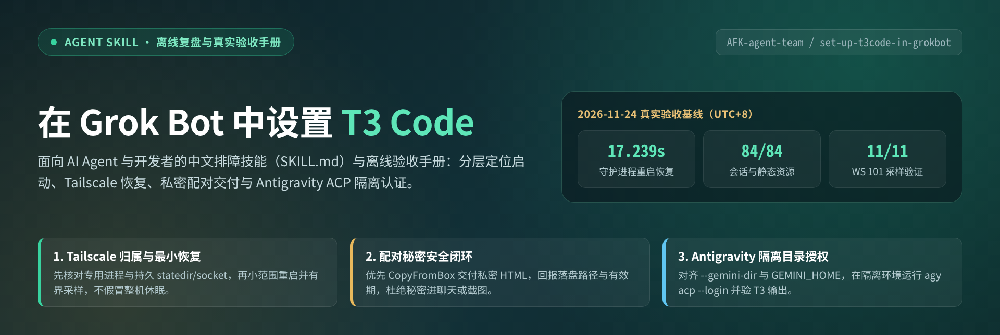
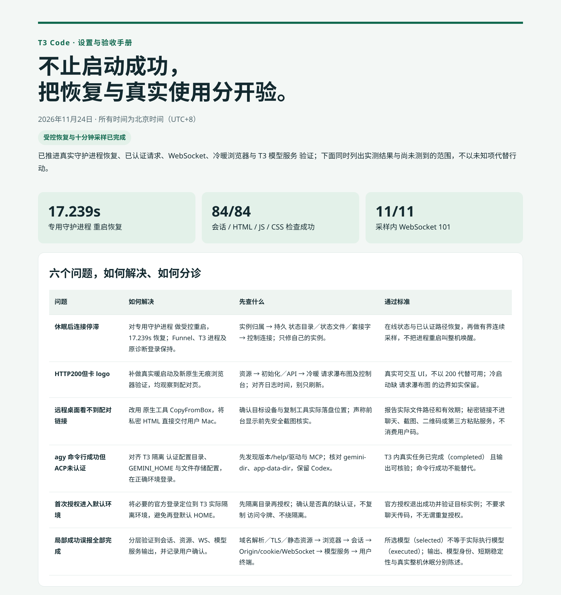
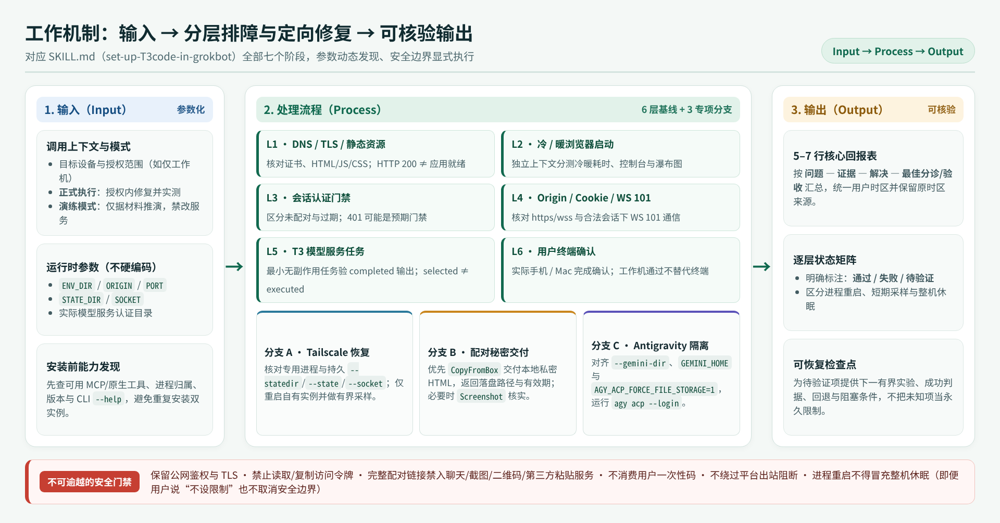

# 在 Grok Bot 中设置 T3 Code

面向 AI Agent 与开发者的 **中文执行技能（`SKILL.md`）** 与 **离线真实验收复盘（`index.html`）**，用于在 Grok Bot 工作机中安全安装、排障与分层验收 T3 Code、Tailscale、远程私密配对与 Antigravity ACP。

[快速开始](#快速开始) · [工作原理](#工作原理) · [核心能力与产物](#核心能力与产物) · [兼容条件矩阵](#兼容条件与运行边界) · [真实验收与演练对比](#真实验收与演练对比) · [常见问题（FAQ）](#常见问题faq) · [贡献与反馈](#贡献与反馈)

> **核心入口**
> - **Agent Skill 正文**：[`SKILL.md`](SKILL.md)（元数据标识 `set-up-T3code-in-grokbot`，供 Agent 加载执行）
> - **离线复盘与排障手册**：[`index.html`](index.html)（单页零脚本离线浏览，内置 6 类问题分诊表与完整技能正文）
> - **初稿演练对照评测页**：[`eval.html`](eval.html)（离线查看 4 份原始技术输出与逐条断言评分）
> - **详细验收时间线与静态校验**：[`docs/verification-evidence.md`](docs/verification-evidence.md)

---

## 适用对象、选型与替代路径

| 维度 | 说明 |
|---|---|
| **适用对象** | 在 Grok Bot 工作机环境中部署、排障或验收 T3 Code 的 AI Agent 与工程师 |
| **何时选用** | 遇到手机/浏览器卡启动标志、HTTP 200 但应用未就绪、Tailscale 休眠停滞、远程私密配对链接交付困难、或 `agy` 命令行成功但隔离 ACP 未认证时 |
| **何时不选用 / 替代路径** | 仅需在非 Grok Bot 普通本机安装 T3 Code → 直接查阅 T3 Code 官方文档与已安装 CLI `--help`；需要在线托管控制台或自动部署脚本 → 本仓库仅提供中文 Skill 与离线复盘页，未部署网站且不包含自动安装脚本 |
| **访问与费用前提** | 本仓库公开免费阅读与本地离线使用，无需注册或等待名单；仅当你在自有环境**正式执行**时，需要对应工作机权限及你自有的 Tailscale / Antigravity 官方账号授权确认 |

---

## 快速开始

### 方式一：本地克隆并打开离线复盘手册

```bash
git clone https://github.com/AFK-agent-team/set-up-t3code-in-grokbot.git
cd set-up-t3code-in-grokbot

# 确保 index.html 与 SKILL.md 位于同一目录后直接打开
# macOS:
open index.html
# Linux:
xdg-open index.html
```

`index.html` 与 `eval.html` 均无脚本、无第三方外部依赖；将文件放在同一目录后可离线互跳并直接下载同目录的 `SKILL.md`。



### 方式二：作为 Agent Skill 加载并执行首次任务

将 [`SKILL.md`](SKILL.md) 放入你的 Agent Skill 目录（保持 frontmatter `name: set-up-T3code-in-grokbot`），或在任务指令中直接引用该文件。

#### 可复制提示词：正式执行模式（在授权范围内排障并实测）

```text
请按本仓库 SKILL.md（set-up-T3code-in-grokbot）执行：
- 运行模式：正式执行（仅操作当前授权工作机，不运行 Mac 命令，不使用 CloudAgent）
- 任务目标：先盘点现有 T3 Code、Tailscale 专用守护进程与 Antigravity ACP 隔离目录（读取真实 --help 与非秘密配置，不硬编码路径），再按 6 层基线排查并做最小可逆修复。
- 输出要求：使用 5–7 行「问题—证据—解决—最佳分诊/验收」表格回报，逐层标明 通过 / 失败 / 待验证，所有时间统一为北京时间（UTC+8）并保留原时区来源。
```

#### 可复制提示词：仅演练模式（只读推演，禁止改动服务与登录）

```text
请按本仓库 SKILL.md（set-up-T3code-in-grokbot）进入演练模式：
仅根据我提供的日志与非秘密配置做分层分诊推演，严禁执行服务变更、登录或官方授权；输出 5–7 行「问题—证据—解决—最佳分诊/验收」表、待验证项及下一项有界实验方案。
```

#### 首次有意义任务的可观察结果
执行完成后，Agent 应交付以下结构化输出（字段与格式由 `SKILL.md` 第七节约束，下列仅示意输出形态；真实数据见下方[真实验收与演练对比](#真实验收与演练对比)）：

- **5–7 行核心回报表**：每行包含 `问题`、`带时间戳的实测证据`、`最小可逆解决动作` 与 `最佳分诊/验收通过标准`；
- **6 层验收状态**：明确列出 DNS/TLS → 冷/暖浏览器 → 会话认证 → Origin/Cookie/WS 101 → T3 模型服务 `completed` 输出 → 用户终端确认各自的 `通过 / 失败 / 待验证` 状态；
- **安全与边界闭环**：若交付配对页，返回 `CopyFromBox` 确认的精确落盘路径与有效期（绝不含秘密原文）；对暂不可测项（如整机休眠）给出可恢复检查点。

---

## 工作原理

完整流程遵循 **输入 → 分层处理与定向修复 → 可核验输出**：



1. **输入（Input）**：从调用上下文确认目标设备、授权边界与执行模式（正式执行 / 演练模式），并动态参数化 `ENV_DIR`、`ORIGIN`、`PORT`、`STATE_DIR`、`SOCKET` 及实际模型服务认证目录，不硬编码下载 URL 或固定路径。
2. **处理（Process）**：
   - **安装前发现**：盘点可用且获授权的 MCP/原生工具、进程归属、版本与 CLI `--help`，避免重复安装双实例。
   - **6 层分层基线**：逐层验证 DNS/TLS/静态资源 → 冷/暖启动浏览器 → 会话认证（区分未配对 401 门禁）→ Origin/Cookie/WS 101 → T3 内无副作用短任务 `completed` 输出 → 用户真实终端确认。
   - **3 类专项修复分支**：Tailscale 专用守护进程最小恢复、私密配对 HTML 的 `CopyFromBox` 落盘闭环、Antigravity 隔离认证目录对齐与授权。
3. **输出（Output）**：输出统一时区的 5–7 行分诊验收表、逐层通过状态、以及面向未测项的有界实验检查点；遇到安全或平台阻断时，仅停止危险分支并报告最小必要人工协助。

---

## 核心能力与产物

下表对应 [`SKILL.md`](SKILL.md) 与 [`index.html`](index.html) 覆盖的六类核心故障场景：

| 故障场景 | 技能执行的实际动作 | 产出物 / 通过标准 |
|---|---|---|
| **Tailscale 休眠后连接停滞** | 核对专用守护进程归属与持久 `--statedir`、`--state`、`--socket`；备份非秘密配置后仅重启自有实例并做有界采样 | 在线状态、控制连接与已认证路径恢复报告；明确区分进程重启与真实整机休眠 |
| **HTTP 200 但卡启动标志** | 使用独立临时上下文拆分冷/暖浏览器启动，记录耗时、控制台与脱敏请求瀑布图并对齐日志时间 | 真实可交互配对页验证记录；不以单次 HTTP 200 代替应用就绪 |
| **远程桌面看不到配对链接** | 优先使用原生 `CopyFromBox` 交付无遥测本地私密 HTML；如需前台核实先用 `Screenshot` 本地检查 | 工具确认的精确落盘路径与有效期（用户时区）；绝不把配对链接写入聊天、截图或第三方粘贴服务 |
| **`agy` 命令行成功但 ACP 未认证** | 按真实驱动与 `--help` 核对 `--gemini-dir`、`--app-data-dir antigravity-acp`、`GEMINI_HOME` 与 `AGY_ACP_FORCE_FILE_STORAGE=1` | 修正目标隔离实例并保留 Codex 及其他模型服务，不复制访问令牌、不绕过隔离 |
| **首次授权进入默认 HOME** | 仅在确认隔离环境确需认证时，于匹配隔离环境执行官方 `agy acp --login` 并核验目标实例 | 官方授权成功退出与隔离实例连通证据；不要求在聊天中发送授权码，不无谓重复授权 |
| **局部成功误报全部完成** | 串联 6 层验收直至 T3 内短任务 `completed` 输出与用户真实终端确认 | 5–7 行分诊表与逐层状态；明确区分 `selected` 与 `executed` 模型，未证实不夸大 |

---

## 兼容条件与运行边界

### 兼容组件与条件矩阵（文档支持说明）

> 以下为 `SKILL.md` 文档支持的组件关系与前提条件；实际 CLI 参数须以目标环境当前 `--help` 输出为准，本仓库不宣称对未实测版本做自动兼容保证。

| 组件 / 工具 | 与本技能的关系 | 生效条件 / 关键配置核对点 |
|---|---|---|
| **Grok Bot 工作机** | 主执行环境 | 遵循调用上下文授权与偏好（例如仅操作工作机、不运行 Mac 命令、不使用 CloudAgent） |
| **T3 Code** | 被安装、排障与验收目标 | 依据官方文档与已安装 CLI `--help` 核对参数；需保留公网鉴权与现有 Codex 配置 |
| **Tailscale 守护进程 / Funnel** | 远程访问与恢复分支 | 必须先确认自有专用实例归属及持久 `STATE_DIR` / `SOCKET`；`no TailscaleVarRoot` 仅为已知故障模式之一；Funnel 仅在用户明确授权时评估 |
| **Antigravity ACP (`agy`)** | 隔离模型服务分支 | 核对 `--gemini-dir`、`--app-data-dir antigravity-acp`、`GEMINI_HOME`、`AGY_ACP_FORCE_FILE_STORAGE=1`；按隔离环境运行 `agy acp --login` |
| **`CopyFromBox` / `Screenshot`** | 原生交付与本地前台核实工具 | 按运行环境实际能力发现；工具缺失时先查受支持替代能力，无安全途径则停止秘密交付分支，严禁降级到公共粘贴服务 |
| **现代桌面浏览器** | 离线查看 `index.html` | 无需网络、脚本或插件，仅需与 `SKILL.md` 同目录即可下载技能文件 |

### 不可逾越的安全边界
- **不关闭安全门禁**：保留公网鉴权与 TLS；遇到平台出站网络阻断时不绕过，如实报告阻塞。
- **不暴露登录秘密**：不读取或复制访问令牌；完整配对链接禁入聊天、截图、二维码、第三方粘贴服务或公共页面；不消费留给用户的一次性配对码。
- **不伪造实验证据**：守护进程重启不等于真实整机休眠；短时连续采样不等于无限期稳定；`executedModel` 为空时不宣称已证明实际执行模型。
- **边界不可被口头覆盖**：即便调用上下文出现“不设限制”，仍保持上述安全与隔离红线。

---

## 真实验收与演练对比

### 1. 2026-11-24 真实验收摘要（北京时间 UTC+8）

完整时间戳与边界记录见 [`docs/verification-evidence.md`](docs/verification-evidence.md)。

| 验收项目 | 实测结果 | 明确边界（不夸大结论） |
|---|---|---|
| **专用守护进程受控重启**（09:53） | 恢复耗时 **17.239s**；Funnel、T3 进程与原诊断登录保持不变 | 不等同于真实整机休眠与唤醒（整机休眠未执行） |
| **10 分钟连续采样**（09:53–10:03） | 21 次采样在线 **21/21**；会话/HTML/JS/CSS 合计 **84/84**；`authenticated=true` **21/21**；JS/CSS 哈希匹配 **21/21**；WS 101 **11/11**；会话 API 延迟中位数 **0.283s**（最大 **1.507s**） | 10 分钟采样不保证无限期稳定；非每个样本均测 WS；收尾已撤销专用诊断会话 |
| **真实浏览器暖启动**（09:54–09:55） | 两次到达配对页，耗时 **1.283s** / **1.071s**，无页面错误 | 仅代表本轮暖启动表现 |
| **新原生无痕浏览器冷启动**（09:57） | 到达配对页耗时**上界 10.976s**（09:57:05.310 启动 → 09:57:16.286 确认） | 上界计时而非精确首屏；未捕获本轮请求瀑布图，不能声称冷启动无错误或解释历史卡 logo 初因 |
| **T3 模型服务任务与用户确认**（09:41 / 09:47） | 选择 `antigravity / gemini-4-neon-low`，任务 `completed`，输出 `T3_ANTIGRAVITY_VERIFIED sum=423`；09:47 用户确认可用 | `selected` ≠ `executed`；`executedModel` 为空，未据此证明实际执行模型身份 |

### 2. 同任务 With / Without Skill 早期演练对比（仅供流程覆盖参考）

离线查看四份原始技术输出与逐条断言评分：[`eval.html`](eval.html)（证据原文中的命令、协议、机器字段及技术术语保持不变；当前部署真实验收以 [`index.html`](index.html) 为准）。

| 原草稿同任务场景 | With Skill（使用技能） | Without Skill（基线） | 差异与取舍说明 |
|---|---:|---:|---|
| **网络排障演练场景** | **8 / 8** | **2 / 8** | 技能强制要求归属核对、持久化路径检查、冷暖拆分与安全红线；基线易凭单次 HTTP 200 误判或漏检 |
| **隔离连接演练场景** | **7 / 10** | **3 / 10** | 技能覆盖目录隔离、环境变量对齐与 T3 任务输出验证；早期草稿仍有 3 项复合断言未全过 |

> **证据声明**：以上演练基线继承了父会话上下文（非严格隔离），仅衡量文本执行计划覆盖率，并非真实网络或稳定性测试；且修订版 `SKILL.md` 未重新评分，不声称当前版本 100% 通过。

---

## 常见问题（FAQ）

<details>
<summary>为什么必须区分「守护进程受控重启」与「真实整机休眠」？</summary>

重启专用守护进程（如实测 17.239s 恢复）只验证进程恢复与状态持久化，无法覆盖内核挂起、网卡驱动重置或宿主机网络栈唤醒问题。因此技能强制将两者分开记录，并在无法休眠共享宿主时输出可恢复检查点，等待自然唤醒或获准窗口复测。

</details>

<details>
<summary>为什么 <code>agy</code> 命令行登录成功了，T3 Code 里的 Antigravity 还是未认证？</summary>

默认 `HOME` 下的 `agy` 登录状态与 T3 Code 隔离运行目录并非同一路径。需要结合当前驱动与 `--help` 核对 `--gemini-dir`、`--app-data-dir antigravity-acp`、`GEMINI_HOME` 与 `AGY_ACP_FORCE_FILE_STORAGE=1`，在匹配的隔离环境中运行 `agy acp --login`，并通过 T3 内实际短任务输出确认。

</details>

<details>
<summary>修改 <code>SKILL.md</code> 后如何验证文档一致性且不误触高风险脚本？</summary>

本仓库目前未配置专用 verify skill 或自动化 CI。请直接运行 [`docs/verification-evidence.md`](docs/verification-evidence.md#三本地静态核对命令不触碰高风险安装脚本) 中的只读 Python 静态核对脚本，它会自动检查 `SKILL.md` 元数据、`index.html` 内嵌 `<pre>` 一致性、零外部脚本要求以及 `README.md` 相对路径有效性。

</details>

<details>
<summary>为什么本仓库没有部署在线演示页或托管试用链接？</summary>

本仓库聚焦可审计的离线交付物：[`index.html`](index.html) 设计为无脚本、无第三方依赖的本地自含复盘页，避免引入外部遥测或在线站点维护成本；真实排障与配对依赖用户自有环境与官方账号，因此提供本地 Quick Start 与可复制提示词作为主入口。

</details>

---

## 仓库结构

```text
set-up-t3code-in-grokbot/
├── README.md                       # 项目主文档与快速开始
├── SKILL.md                        # 中文 Agent Skill（name: set-up-T3code-in-grokbot）
├── index.html                      # 离线自含复盘与分诊手册（零脚本、无第三方依赖）
├── eval.html                       # 离线初稿演练对照评测页（4 份原始技术输出与逐条评分）
├── CONTRIBUTING.md                 # 贡献流程、同步规则与脱敏红线
├── docs/
│   └── verification-evidence.md    # 详细 UTC+8 验收时间线、演练边界与静态核对命令
└── assets/
    ├── cover.png                   # 封面视觉定位图
    ├── triage-workflow.png         # 输入 → 6 层排障与 3 分支修复 → 输出架构图
    └── index-html-screenshot.png   # index.html 真实浏览器渲染截图
```

---

## 贡献与反馈

- **参与贡献**：欢迎通过 [`CONTRIBUTING.md`](CONTRIBUTING.md) 提交新的脱敏分诊案例、参数变更记录或离线验收复测；修改 `SKILL.md` 时请同步更新 `index.html` 内嵌正文并通过本地静态校验。
- **问题反馈**：请使用 [GitHub Issues](https://github.com/AFK-agent-team/set-up-t3code-in-grokbot/issues) 反馈故障场景或文档建议（提交前请务必按脱敏红线移除个人域名、Token 与配对链接）。
- **维护与许可**：当前由 [AFK-agent-team](https://github.com/AFK-agent-team) / [@liush2yuxjtu](https://github.com/liush2yuxjtu) 维护（[提交记录](https://github.com/AFK-agent-team/set-up-t3code-in-grokbot/commits/main)）。仓库当前**尚未添加开源许可证**，如需再分发请先在 Issue 中沟通确认。
